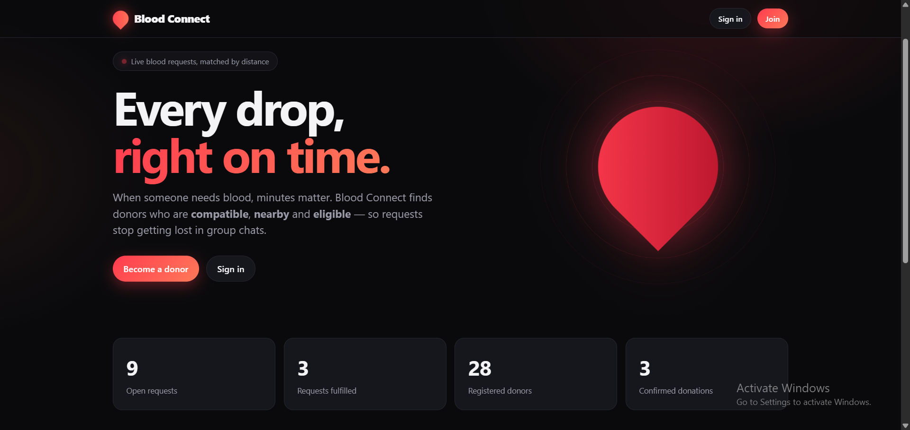
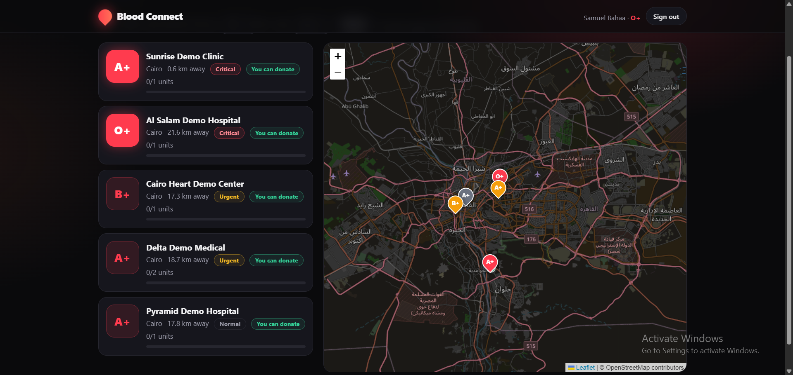
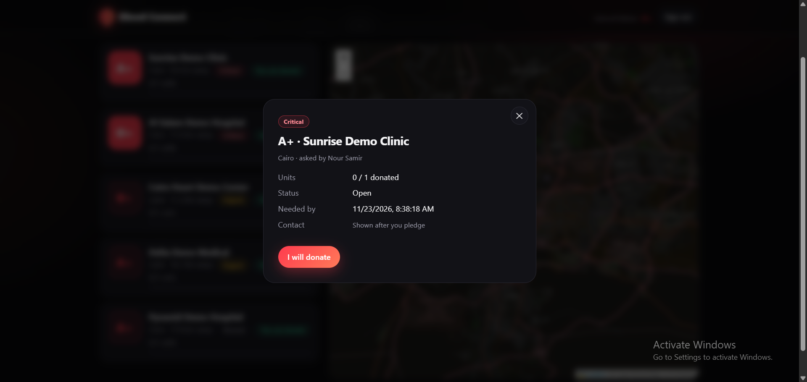

# Blood Connect

**Matching urgent blood requests with compatible, nearby, eligible donors.**



## The problem
When a patient needs blood, the family posts on Facebook or WhatsApp groups. The post gets buried, reaches people with the wrong blood type, people who live far away, or people who donated last month — and nobody knows when the request is already covered.

## The solution
Blood Connect matches by **blood-type compatibility + distance + donor eligibility**:

- A request carries blood type, units, hospital, location and urgency (Normal / Urgent / Critical).
- Donors only see requests they can actually help with — **most urgent first, then closest**.
- A donor pledges, the requester confirms the donation, and the donor is locked out for 56 days.
- Privacy by design: the patient name is visible only to the requester; the contact phone only to the requester and to donors who pledged.





## How it works (engineering notes)
| Concern | Approach |
|---|---|
| Authentication | JWT bearer tokens; passwords hashed with BCrypt (salted, slow on purpose); generic login error so e-mail existence is not leaked |
| Blood compatibility | Explicit donor → recipient matrix (e.g. O- can give to everyone, AB+ can receive from everyone) |
| Nearby search | Bounding box in SQL to discard far rows, then exact Haversine distance in memory |
| Eligibility | Available flag + minimum days since last donation (configurable, default 56) |
| Data integrity | Unique (request, donor) pledge index; max 5 open requests per user (anti-spam) |
| Privacy | Owner sees only the *count* of nearby eligible donors, never their identities |
| Validation | DataAnnotations on every DTO; enums serialised as strings |

**Stack:** ASP.NET Core Web API (.NET 10) · EF Core + SQL Server · JWT · BCrypt · OpenAPI + Scalar · vanilla JS dashboard · Leaflet + OpenStreetMap.

## Run it locally
Requirements: .NET 10 SDK and SQL Server LocalDB (installed with Visual Studio) or any SQL Server (edit the connection string).

```bash
git clone https://github.com/samuelbahaa/BloodConnect.git
cd BloodConnect

# secret JWT signing key (kept outside the repo)
dotnet user-secrets init
dotnet user-secrets set "Jwt:Key" "put-a-long-random-string-of-32-plus-characters-here"

dotnet run
```

Open **http://localhost:5117** for the dashboard, or **/scalar** for the interactive API docs.

In Development the app applies the migrations and seeds demo data on first start (24 donors, 12 requests around Cairo).
Demo accounts: `demo1@demo.bloodconnect` … `demo24@demo.bloodconnect` — password `Demo@12345`. Or register your own.

## API overview
| Method | Route | Notes |
|---|---|---|
| POST | `/api/auth/register`, `/api/auth/login` | returns a JWT |
| GET / PUT | `/api/profile/me` | profile, blood type, location, availability |
| GET | `/api/profile/pledges` | my pledges |
| GET | `/api/requests` | filters: `bloodType`, `city`, `status`, `lat`/`lng`/`radiusKm`, `compatibleWithMe`, paging |
| POST | `/api/requests` | create a request |
| GET | `/api/requests/{id}`, `/api/requests/mine` | details / my requests |
| POST / DELETE | `/api/requests/{id}/pledge` | pledge / cancel pledge |
| POST | `/api/requests/{id}/pledges/{pledgeId}/confirm` | owner confirms a donation |
| POST | `/api/requests/{id}/cancel` | owner closes the request |
| GET | `/api/stats` | public totals |

## Roadmap
SignalR real-time alerts · background job to expire old requests · Flutter mobile app · automated tests.

## Notes
Demo data is fictional (fake names, phones and hospitals). This is a portfolio project, not a medical product.
